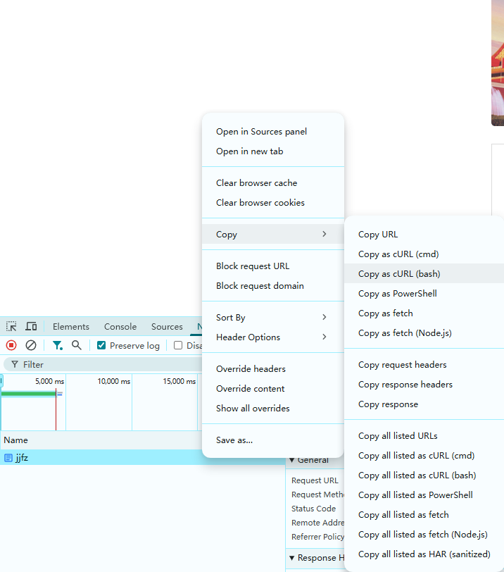
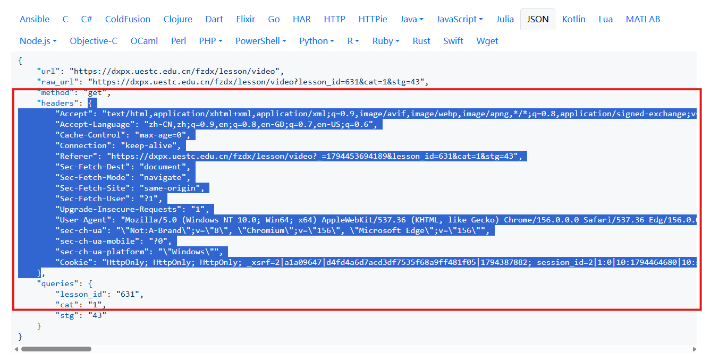
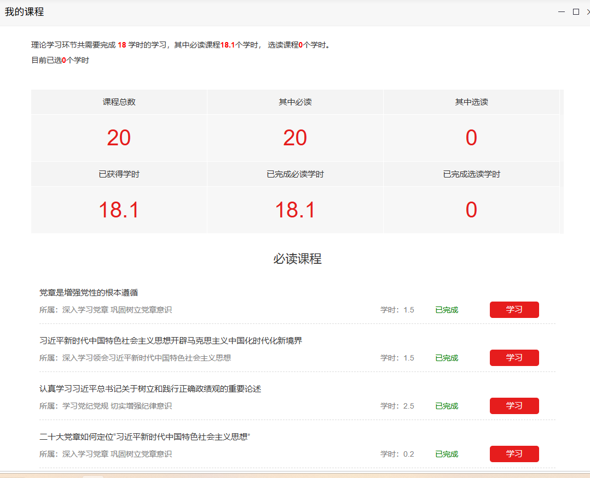

# 电子科技大学（UESTC）党校培训（积极分子和发展对象）脚本
## All you need is a Python script!
2025.11.21 经过测试，脚本顺利运行，并完成所有课程的观看任务。后续会考虑加入发展对象相关的支持。<br>
2026.05.20 对本期积极分子课程再次进行测试，顺利完成所有任务。<br>
2026.06.01 增加发展对象的视频课程、考试支持，并完成测试。<br>
2026.11.12 对新版线上系统进行适配性改造，增加自动登录的功能，并完成测试。<br>

## 使用方法
### 1. 安装依赖
建议使用 Python 3.13。以下命令均在项目根目录（本 `readme.md` 所在目录）执行。

#### 1.1 使用普通 Python

创建虚拟环境并安装依赖：

```powershell
python -m venv .venv
.\.venv\Scripts\Activate.ps1
python -m pip install --upgrade pip
python -m pip install -r requirements.txt
```

如果 PowerShell 禁止执行激活脚本，也可以直接使用虚拟环境中的 Python：

```powershell
.\.venv\Scripts\python.exe main.py fzdx --init
```

Linux/macOS 可使用：

```bash
python3 -m venv .venv
source .venv/bin/activate
python -m pip install --upgrade pip
python -m pip install -r requirements.txt
```

#### 1.2 使用 uv（可选）

如果已安装 `uv`，也可以使用项目锁定的依赖：

```powershell
uv sync --locked
```

接下来配置账户信息。

### 2. 认证配置
#### 2.1 自动登录（推荐）
在项目根目录的 `.env` 中配置账号和密码（格式参见 `.env.example`）：

```dotenv
DXPX_SID=你的账号
DXPX_PASSWORD=你的原始密码
```

填写原始密码，已有同名系统环境变量优先于 `.env`。

运行 `main.py` 时会自动进行认证，无需手动执行登录脚本：先使用根目录 `.env` 中的账号密码登录；未配置或登录失败时，再读取并验证 `headers.json`；两种方式均失败时，提示配置账号密码或有效的 `headers.json`。
不配置账号密码时，也可以使用下方的手动复制方式。

#### 2.2 手动配置

1. **复制请求**

   登录自己的积极分子或发展对象账号后，打开浏览器开发者工具（如 Chrome 或 Edge 的 F12），切换到 Network（网络）标签页。刷新页面，选择对应培训页面的请求，在 Headers（标头）中的 Request Headers（请求标头）查看 `Cookie`、`User-Agent`、`Referer` 等字段。也可以右键请求，选择“Copy”，再点击“Copy as cURL”，在本地查看完整请求。<br>
   <br>

2. **转换为 JSON 代码**

   打开 [curlconverter.com](https://curlconverter.com/json/)，将复制的 cURL 命令粘贴到网站中，再复制生成的 JSON 代码。<br>
   <br>

3. **保存到 headers.json**

   将刚刚复制的 `headers` 字段保存到项目根目录的 `headers.json` 中。

> 如果不想用默认路径 `headers.json`，可以通过 `--headers-file` 指定其他位置：
> ```bash
> python main.py jjfz --init --headers-file "C:/path/to/your/headers.json"
> ```
> 这样就**不需要**再手动改任何脚本里的代码了。

#### 2.3 运行脚本
所有命令都建议在项目根目录运行，也就是本 `readme.md` 所在目录。

命令格式和主要参数如下：

| 命令或参数 | 说明 | 示例 |
| --- | --- | --- |
| `jjfz` | 运行积极分子相关功能 | `python main.py jjfz ...` |
| `fzdx` | 运行发展对象相关功能 | `python main.py fzdx ...` |
| `--help` | 查看全部命令和参数说明 | `python main.py jjfz --help` |
| `--init` | 采集课程信息、提交观看记录并保存 | `python main.py fzdx --init` |
| `--update` | 根据已完成考试结果更新本地题库 | `python main.py jjfz --update` |
| `--exam` | 运行考试流程，不能与学习操作同时使用 | `python main.py fzdx --exam` |
| `--score` | 查询综合考试历史成绩并显示最高分，单独使用；支持 jjfz、fzdx | `python main.py fzdx --score` |
| `--lessons LESSON_ID ...` | 完成积极分子指定课程的视频任务 | `python main.py jjfz --lessons 567 568` |
| `--mode end\|lesson` | 选择积极分子综合考试或章节测试 | `python main.py jjfz --exam --mode lesson` |
| `--echos NUMBER` | 设置考试执行轮数；积极分子默认 30，发展对象默认 10 | `python main.py fzdx --exam --echos 1` |
| `--output-dir DIRECTORY` | 指定课程信息保存目录 | `python main.py jjfz --init --output-dir dxpx/jjfz/temp` |
| `--headers-file FILE` | 指定请求头 JSON 文件路径 | `python main.py jjfz --init --headers-file headers.json` |

```bash
python main.py --help
python main.py jjfz --help
python main.py fzdx --help
```

学习操作可以组合，例如 `python main.py jjfz --init --update`；考试使用 `--exam`，不可与学习操作混用。

### 3. 积极分子（jjfz）
#### 3.1 初始化课程信息
获取课程信息并保存到默认目录：
```bash
python main.py jjfz --init
```

指定课程信息保存目录：
```bash
python main.py jjfz --init --output-dir dxpx/jjfz/temp
```

> `--init` 会采集课程信息、提交观看记录并保存到 `lessons.json`。资源按 `(video_id, resource_id)` 去重，同一视频的不同分节均保留。接口接受记录不代表网站进度已完成，请以平台显示为准；对未完成的指定课程，可使用 3.4 中的 `--lessons` 重试。积极分子请求默认使用阶段 `42`，发展对象默认使用阶段 `43`。

#### 3.2 更新本地题库
从已完成的综合考试和章节测试记录中抓取题目，去重后更新本地题库：
```bash
python main.py jjfz --update
```

#### 3.3 自动完成考试
综合提升考试，默认模式为 `end`：
```bash
python main.py jjfz --exam --mode end --echos 30
```

章节测试：
```bash
python main.py jjfz --exam --mode lesson --echos 30
```

`--echos` 表示循环执行次数，可根据需要调整。

#### 3.4 提交观看记录
1. 完成所有观看任务，会打印未完成的课程列表到控制台，供后续步骤2处理：
    ```bash
    python main.py jjfz --init
    ```
   默认会保存课程信息到[temp 目录](dxpx/jjfz/temp)，可以使用 `--output-dir` 指定其他位置。
2. 仅完成指定 lessons 的所有必修视频观看任务：
    ```bash
    python main.py jjfz --lessons 567 568 569
    ```

### 4. 发展对象（fzdx）
#### 4.1 初始化课程信息
获取课程信息并保存到默认目录：
```bash
python main.py fzdx --init
```

指定课程信息保存目录：
```bash
python main.py fzdx --init --output-dir dxpx/fzdx/temp
```

#### 4.2 更新本地题库
从已完成的考试记录中抓取题目，去重后更新本地题库：
```bash
python main.py fzdx --update
```

#### 4.3 自动完成考试
```bash
python main.py fzdx --exam --echos 10
```

`--echos` 表示循环执行次数，可根据需要调整。

### 5. 测试
运行全部测试：

```powershell
python -m unittest discover -s tests -p "test_*.py"
```

登录和会话测试会发起真实请求，并可能更新 `headers.json`。仅运行命令行、启动认证和课程逻辑的离线测试：

```powershell
python -m unittest tests.test_main tests.test_auth_startup tests.test_player_logic
```

## 主要功能
### 1. 视频刷课
积极分子：<br>
`python main.py jjfz --init` —— 完成观看任务，采集课程信息并保存到 `lessons.json`。<br>
`python main.py jjfz --lessons LESSON_ID ...` —— 完成指定课程的观看任务，该功能用于只需完成部分课程观看任务的情况。

发展对象:<br>
`python main.py fzdx --init` —— 完成观看任务，采集课程信息并保存到 `lessons.json`

### 2. 章节测试刷题
积极分子脚本支持章节测试，运行：
```bash
python main.py jjfz --exam --mode lesson --echos 30
```

### 3. 综合考试刷题
积极分子综合考试：
```bash
python main.py jjfz --exam --mode end --echos 30
```

发展对象考试：
```bash
python main.py fzdx --exam --echos 10
```

### 4. 获取系统题库
建议先运行十次以上自动刷题，以在系统上留下考试记录。脚本会通过查询考试记录，获取所有考题，然后去重、按拼音排序、分类（单选、多选、判断、填空）。<br>
更新题库可以直接运行：<br>
**积极分子：**
```bash
python main.py jjfz --update
```
**发展对象：**
```bash
python main.py fzdx --update
```

## 运行效果
### 1. 视频刷课
截至到测试时间，脚本顺利运行，并完成所有课程的观看任务。<br>

**积极分子视频刷课：**

**发展对象视频刷课：**


### 2. 积极分子章节测试刷题
截至到测试时间，脚本顺利运行，并完成所有章节测试。<br>


### 3. 综合测试刷题
获得满分**100分**！


## 其他脚本
[研究生英语-学堂在线刷题脚本](mooc/english.py)，题目和答案见[研究生英语-学堂在线题库](doc/mooc/english.txt)。

## 注意事项
1. 平台请求会自动接收续期 Cookie，并写回加载的 `headers.json`，同时同步 `_xsrf`。身份失效时使用根目录 `.env` 中的账号密码重新登录；只读请求重试一次，提交请求若在执行时失效则提示重新开始，不自动重复提交。程序关闭期间不会后台保活。
2. 脚本运行完成后，会在控制台输出完成信息。
3. 使用刷题功能时，由于做题时系统给出的题目中空格等符号的数量可能与本地题库不一致，导致判断错题的逻辑错误，但是会保证你能得到不错的分数。
4. **本项目仅供技术学习交流,为此引出的任何与技术无关的问题与作者本人无关**
